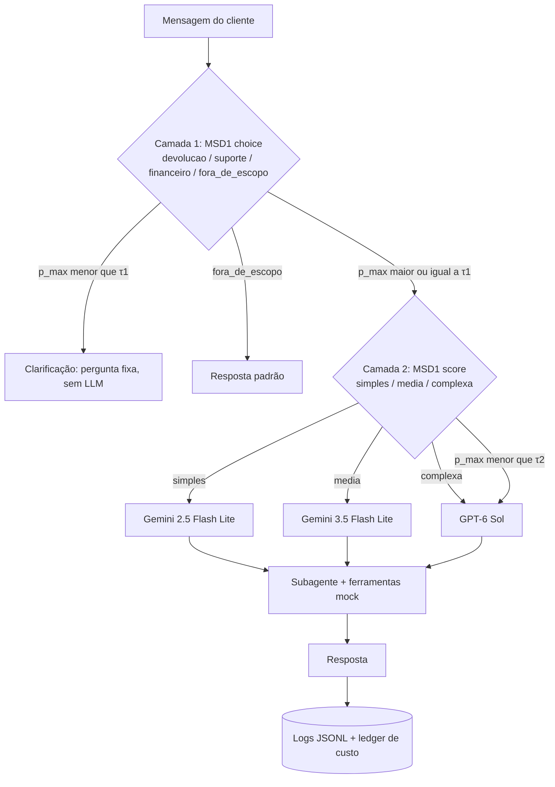
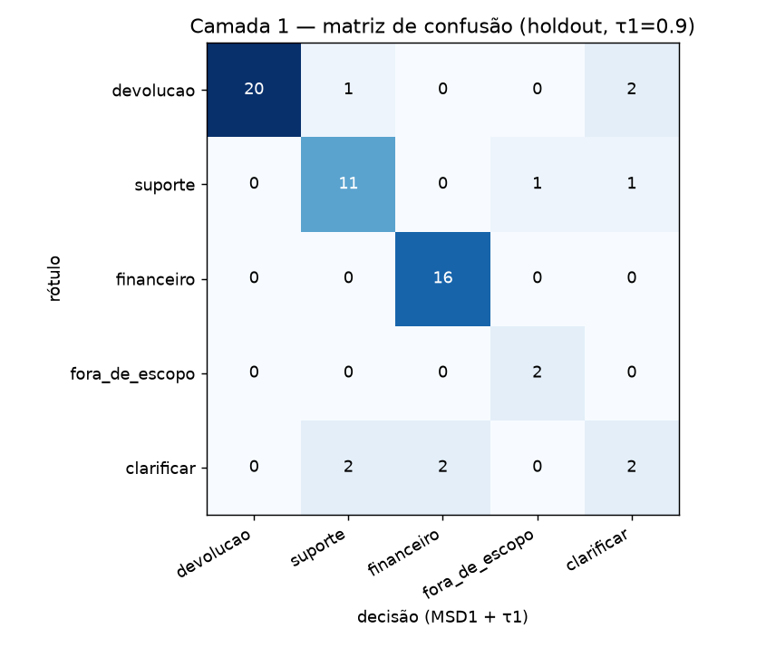
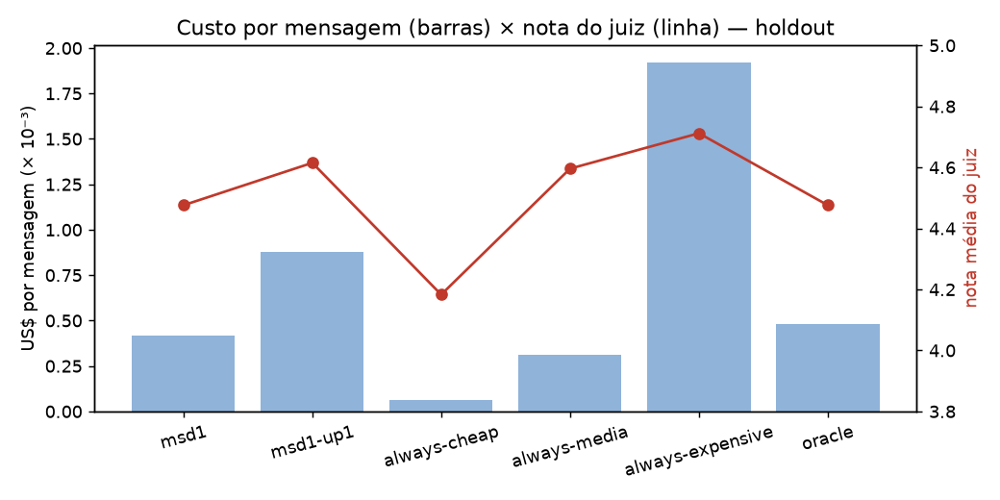
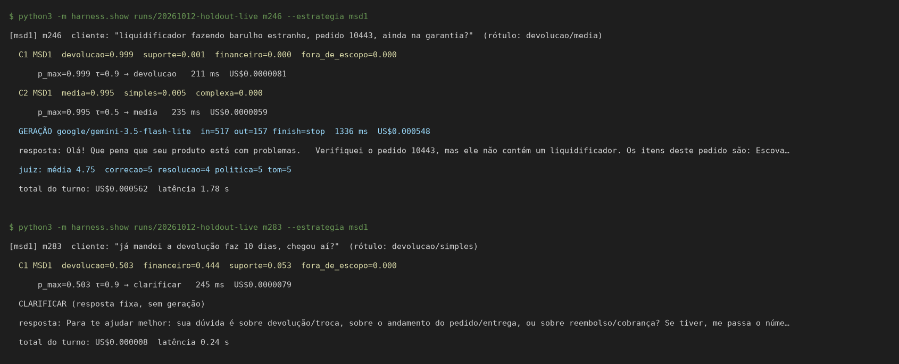

# Modelos de decisão num chatbot de pós-venda

> POC em que eu testei o **Microsoft-Decision-1 (MSD1)** como camada de decisão de um chatbot de pós-venda: primeiro para escolher o subagente certo (com pedido de clarificação quando a confiança é baixa) e depois para escolher entre três LLMs de custos diferentes conforme a complexidade da mensagem. Construí tudo com dados 100% fictícios, um teto rígido de US$20 de API e gastei **US$0,30** no total.


## O problema

Chatbots de atendimento costumam usar um único modelo caro para tudo, ou um LLM gerativo como "roteador". Eu queria responder duas perguntas com números reais:

1. Um modelo de decisão pequeno, que devolve **probabilidades calibradas por opção** em vez de texto, consegue rotear mensagens para o subagente certo e saber quando deve perguntar de volta?
2. Usando o mesmo modelo para estimar a complexidade da mensagem, dá para mandar o caso fácil para um modelo barato e o difícil para um caro, **economizando sem perder qualidade**?

## Arquitetura



| Subagente | O que atende |
|---|---|
| `devolucao` | devolução, troca, arrependimento, defeito, etiqueta e coleta |
| `suporte` | status e rastreio, entrega, endereço, cancelamento antes do envio, conta, uso do produto |
| `financeiro` | reembolso, cobrança (duplicada, indevida, juros, boleto), estorno |

As ferramentas (consulta de pedido e política da loja) são mocks determinísticos de uma loja fictícia, a "LojaExemplo", com 60 pedidos inventados (`mocks/dados.py`). O resultado da ferramenta entra no prompt do subagente.

## As duas camadas de decisão

**O MSD1.** O `microsoft/microsoft-decision-1` (versão `-20261009`, servido pela Azure via OpenRouter) é um Qwen3.5-9B pós-treinado que não gera texto: recebe um estado e perguntas com opções fixas e devolve a probabilidade de cada opção. Usei o endpoint `POST https://openrouter.ai/api/alpha/decisions`. Ele custa US$0,042 por milhão de tokens de entrada; cada decisão minha saiu por **~US$0,000008** e **~230 ms**.

**Camada 1 — routing (`type: choice`).** Quatro opções, cada uma com uma descrição. Se a maior probabilidade fica abaixo de **τ1 = 0,9**, o chatbot não arrisca: pergunta ao cliente se o assunto é devolução, pedido ou dinheiro.

**Camada 2 — escolha do modelo (`type: score`).** Uma escala ordinal 0/1/2 (simples / média / complexa) que mapeia para três modelos:

| Tier | Modelo | US$/1M tokens (entrada / saída) | max_tokens |
|---|---|---|---|
| simples | `google/gemini-2.5-flash-lite` | 0,10 / 0,40 | 400 |
| média | `google/gemini-3.5-flash-lite` | 0,30 / 2,50 | 400 |
| complexa | `openai/gpt-6-sol` | 2,00 / 10,00 | 800 |

Se a confiança fica abaixo de **τ2 = 0,5**, sobe direto para o caro. Também testei uma variante (`msd1-up1`) que sobe só **um** tier, com τ2 = 0,98.

Escolhi os thresholds no split de calibração (180 mensagens), maximizando uma função de utilidade que defini antes de olhar o teste, e congelei em `config/thresholds.json` antes de rodar o holdout.

**Juiz.** `deepseek/deepseek-v4.1-flash`, de outra família, dá notas de 1 a 5 em correção, resolução, política e tom.

## Resultados (holdout: 60 mensagens × 6 estratégias)

| Estratégia | US$/msg | Economia vs sempre caro (IC95%) | Nota do juiz (IC95%) | % nota ≥ 4 | Latência P50 / P95 |
|---|---:|---:|---:|---:|---:|
| **msd1** (C1 + C2) | 0,000417 | 78,3% (67,9–86,7) | 4,48 (4,31–4,62) | 90,4% | 1,34 s / 5,07 s |
| msd1-up1 (fallback +1 tier) | 0,000880 | 54,1% (42,4–65,4) | 4,62 (4,50–4,72) | 96,2% | 1,67 s / 5,95 s |
| always-cheap | 0,000063 | 96,7% (96,4–97,0) | 4,18 (3,96–4,40) | 71,2% | 0,90 s / 1,82 s |
| always-media | 0,000312 | 83,7% (82,1–85,3) | 4,60 (4,50–4,69) | 96,2% | 1,28 s / 1,78 s |
| always-expensive | 0,001919 | — | 4,71 (4,67–4,75) | 100% | 3,18 s / 6,07 s |
| oracle (tier do rótulo do dataset) | 0,000481 | 74,9% (64,2–85,2) | 4,48 (4,32–4,62) | 88,5% | 0,93 s / 3,85 s |

**Camada 1 (routing):**
- Acurácia nas mensagens claras: **94,4%** no holdout (94,0% na calibração).
- Com τ1 = 0,9: clarificação em **8,3%** das mensagens, sendo 5,6% desnecessárias.
- Erro entre as mensagens aceitas: **3,9%**; as 6 ambíguas do holdout foram tratadas de forma aceitável.
- Calibração das probabilidades: **ECE 0,054**.

**Camada 2 (modelo):**
- Acerto do tier contra o rótulo do dataset: **70,8%**.
- Mandou para um tier abaixo do necessário em **22,9%** dos casos (na variante +1 tier, 6,2%).

**Truncamento:** nenhuma resposta foi cortada por `max_tokens`, em nenhum modelo.

<p>
  
  
</p>
<p>
  
  
</p>
<p>
  
  
</p>

O relatório completo, com matriz de confusão, IC por bootstrap e tabelas, está em [`RESULTADOS.md`](RESULTADOS.md). Todos os números vêm dos logs em `runs/` via `harness/report.py`; não digitei nenhum à mão.

## Exemplos reais

### Uma mensagem passando pelas duas camadas

O rastro abaixo é renderizado pelo `harness/show.py` a partir dos logs gravados (não chama a API de novo):



```text
$ python3 -m harness.show runs/20261012-holdout-live m246 --estrategia msd1
[msd1] m246  cliente: "liquidificador fazendo barulho estranho, pedido 10443, ainda na garantia?"  (rótulo: devolucao/media)
  C1 MSD1  devolucao=0.999  suporte=0.001  financeiro=0.000  fora_de_escopo=0.000
      p_max=0.999 τ=0.9 → devolucao   211 ms  US$0.0000081
  C2 MSD1  media=0.995  simples=0.005  complexa=0.000
      p_max=0.995 τ=0.5 → media   235 ms  US$0.0000059
  GERAÇÃO google/gemini-3.5-flash-lite  in=517 out=157 finish=stop  1336 ms  US$0.000548
  resposta: Olá! Que pena que seu produto está com problemas.   Verifiquei o pedido 10443, mas ele não contém um liquidificador. Os itens deste pedido são: Escova…
  juiz: média 4.75  correcao=5 resolucao=4 politica=5 tom=5
  total do turno: US$0.000562  latência 1.78 s
```

### Um caso de clarificação

O MSD1 ficou dividido entre devolução e financeiro. Como 0,503 < τ1, o chatbot perguntou em vez de chutar, e isso custou só a decisão:

```text
$ python3 -m harness.show runs/20261012-holdout-live m283 --estrategia msd1
[msd1] m283  cliente: "já mandei a devolução faz 10 dias, chegou aí?"  (rótulo: devolucao/simples)
  C1 MSD1  devolucao=0.503  financeiro=0.444  suporte=0.053  fora_de_escopo=0.000
      p_max=0.503 τ=0.9 → clarificar   245 ms  US$0.0000079
  CLARIFICAR (resposta fixa, sem geração)
  resposta: Para te ajudar melhor: sua dúvida é sobre devolução/troca, sobre o andamento do pedido/entrega, ou sobre reembolso/cobrança? Se tiver, me passa o núme…
  total do turno: US$0.000008  latência 0.24 s
```

Outras decisões reais da Camada 1 no holdout (de [`report/exemplos-routing.md`](report/exemplos-routing.md)):

| Mensagem | Probabilidades do MSD1 | Decisão com τ1 = 0,9 | Rótulo do dataset |
|---|---|---|---|
| "como declaro imposto de renda?" | fora_de_escopo 1,000 | fora_de_escopo | fora_de_escopo ✅ |
| "ajuda" | suporte 0,592 · fora_de_escopo 0,407 | clarificar | ambígua ✅ |
| "não quero mais" | devolucao 0,749 · suporte 0,243 | clarificar | ambígua ✅ |
| "devolve o dinheiro se eu devolver o fone?" | devolucao 0,651 · financeiro 0,349 | clarificar | devolucao (clarificação desnecessária) |
| "o rastreio diz 'objeto aguardando retirada', onde retiro?" | devolucao 0,852 · suporte 0,148 | clarificar | suporte (o τ1 evitou um erro) |
| "posso acompanhar pelo whatsapp?" | fora_de_escopo 0,981 · suporte 0,018 | fora_de_escopo | suporte ❌ |

### A mesma mensagem nos três modelos

Mensagem `m246`: *"liquidificador fazendo barulho estranho, pedido 10443, ainda na garantia?"*. A ferramenta mock mostra que o pedido 10443 **não tem** liquidificador (são escova elétrica, tênis e fone), status `devolucao_em_andamento`, 33 dias desde a entrega.

| Modelo | Tokens in/out | Custo da geração | Latência | Nota do juiz | Trecho da resposta |
|---|---:|---:|---:|---:|---|
| Gemini 2.5 Flash Lite (always-cheap) | 517 / 68 | US$0,000079 | 0,70 s | **2,00** | "O liquidificador, por ser um item de higiene pessoal, tem o prazo de devolução por defeito de até 30 dias… infelizmente não consigo prosseguir" |
| Gemini 3.5 Flash Lite (escolhido pelo msd1) | 517 / 157 | US$0,000548 | 1,34 s | **4,75** | "Verifiquei o pedido 10443, mas ele não contém um liquidificador… Poderia confirmar o número do pedido correto?" |
| GPT-6 Sol (always-expensive) | 476 / 127 | US$0,002222 | 3,77 s | **4,75** | "No pedido 10443, não consta um liquidificador… Você pode conferir o número do pedido do liquidificador?" |

O modelo barato inventou que o liquidificador estava no pedido. Já o médio acertou como o caro, por um quarto do preço. É exatamente o caso que a Camada 2 deveria pegar, e aqui ela pegou.

## Guarda de custo

Rodei tudo com um **teto rígido de US$20** e parada automática em **US$18** (`config/budget.json`):

- `harness/budget.py` mantém um ledger persistente (`runs/ledger.json`).
- Antes de **cada** chamada, ele reserva o pior custo possível (tokens estimados do prompt × preço de entrada + `max_tokens` × preço de saída).
- Se `gasto + reserva` passar de US$18, levanta `BudgetExceeded`, interrompe a execução e grava `status: ABORTADO_ORCAMENTO` no `manifest.json`.
- Também há `--session-cap` para limitar uma execução específica (usei US$0,08 no smoke test).
- O custo de cada chamada é o `usage.cost` devolvido pelo OpenRouter. No fim, conferi o ledger com `GET /api/v1/key`, que bateu exatamente: **US$0,2971**.
- Antes da rodada principal fiz a estimativa em [`ESTIMATIVA_CUSTO.md`](ESTIMATIVA_CUSTO.md): US$0,73 no cenário central e US$1,68 no pessimista.

Saídas reais das execuções:

```text
$ python3 -m harness.calibrate --live
{"n": 180, "n_c2": 149, "tau1": 0.9, "tau2": 0.5, "gasto_usd": 0.0022035720000000026} runs/20261012-085619-calib-live

$ python3 -m harness.run --live --split holdout --estrategias msd1,msd1-up1,always-cheap,always-media,always-expensive,oracle --out runs/20261012-holdout-live
runs/20261012-holdout-live  status=ok  gasto_sessao=US$0.242438  ledger=US$0.256619
```

Ledger final (`runs/ledger.json`):

```json
{
  "spent_usd": 0.29710383100000026,
  "calls": 1144,
  "by_model": {
    "microsoft/microsoft-decision-1": 0.00330338400000001,
    "google/gemini-3.5-flash-lite": 0.045361200000000004,
    "google/gemini-2.5-flash-lite": 0.007209500000000002,
    "openai/gpt-6-sol": 0.1999,
    "deepseek/deepseek-v4.1-flash": 0.04132974700000001
  }
}
```

A chave nunca entra no código: vem só da variável `OPENROUTER_API_KEY` (veja `.env.example`), e o `.env` está no `.gitignore`.

## O que eu concluí

- **A Camada 1 funciona.** O MSD1 roteou 94,4% das mensagens claras corretamente, com probabilidades bem calibradas e ~230 ms por decisão, a um custo desprezível. O threshold dá um controle explícito entre errar e perguntar.
- **A Camada 2, do jeito que eu montei, não se pagou.** O msd1 economiza 78% em relação a sempre usar o GPT-6 Sol, mas **always-media é mais barato e tem nota maior** (4,60 vs 4,48): o msd1 fica fora da fronteira de Pareto. A variante +1 tier chega a 4,62, mas economiza só 54%.
- **O gargalo é a definição de "complexidade", não o modelo de decisão.** Os rótulos de tier do dataset concordam com o tier empírico (o mais barato que o juiz considera tão bom quanto o melhor) em só 47,9% dos casos. Até o `oracle`, que usa esse rótulo, fica abaixo do always-media.
- O overhead das decisões (~0,2 a 0,5 s, ~US$0,00001) é pequeno perto da geração, principalmente perto do GPT-6 Sol (3,2 s de P50).

## Limitações

- **As 300 mensagens e os rótulos (subagente e tier) foram gerados com apoio de um LLM e ainda não passaram por revisão humana.** A planilha de revisão está em [`report/revisao_rotulos.csv`](report/revisao_rotulos.csv).
- O juiz é um único modelo barato. Ainda vou calibrar com a planilha cega de 40 respostas (`runs/20261012-holdout-live/revisao_humana_juiz.csv`).
- O holdout é pequeno (60 mensagens, ~52 respostas geradas por estratégia): diferenças de nota abaixo de ~0,3 não são conclusivas.
- Mensagens sintéticas e de turno único, geradas com apoio de um LLM a partir das minhas instruções; ferramentas mock no prompt, sem tool-calling real.
- Medi a latência de um único servidor Linux em São Paulo, num só horário.
- O manifest da rodada registra o sha256 do dataset antes de eu renomear um campo de metadados (`rotulo_autor` → `rotulo_status`); mensagens, rótulos e splits não mudaram.

## Fase 3 (em preparação)

Preparei uma terceira fase para testar se a derrota da Camada 2 para always-media foi efeito do teste pequeno: 1000 conversas multi-turno com contexto de pedido, distribuição realista de complexidade, coleta em grade com replay pareado, três variantes da Camada 2 (incluindo uma que vê o resultado da ferramenta) e testes de significância. A análise dos dados da Fase 2 já mostrou que o modelo barato passa em 93% das mensagens sem nº de pedido e em só 23% das que exigem cruzar o pedido com a política. Detalhes em [`PLANO_FASE3.md`](PLANO_FASE3.md), custo em [`ESTIMATIVA_CUSTO_FASE3.md`](ESTIMATIVA_CUSTO_FASE3.md).

## Próximos passos

1. Revisão humana dos rótulos e calibração do juiz com a planilha cega (kappa ponderado).
2. Rotular o tier de forma **empírica** (o mais barato que passa no juiz) e recalibrar o τ2 em cima disso.
3. Testar outras perguntas para a Camada 2 (por exemplo, "o modelo barato resolve isto?" como `noul`) em vez da escala de complexidade.
4. Conversas multi-turno com tool-calling real.
5. Comparar a Camada 1 com um router gerativo (GPT-6 Luna) e com outros modelos de decisão (Jev, OpenAI Decisions).
6. Aumentar o holdout para estreitar os intervalos de confiança.

## Como rodar

Requer Python 3.11+; o harness usa só a stdlib. Os gráficos usam `matplotlib`.

```bash
python3 -m venv .venv && .venv/bin/pip install matplotlib
cp .env.example .env            # coloque sua OPENROUTER_API_KEY e exporte no shell

python3 -m unittest -v tests.test_poc                 # 10 testes, tudo com mocks
python3 datasets/gerar_dataset.py                     # regenera o dataset (determinístico)
python3 -m harness.estimate --refresh                 # preços ao vivo -> ESTIMATIVA_CUSTO.md
python3 -m harness.run --mock --split holdout         # dry-run sem custo

# com API real
python3 -m harness.calibrate --live                   # escolhe e congela τ1/τ2 no split calib
python3 -m harness.run --live --split holdout \
  --estrategias msd1,msd1-up1,always-cheap,always-media,always-expensive,oracle
python3 -m harness.judge runs/<dir> --live --amostra 1000
.venv/bin/python -m harness.report runs/<dir-holdout> runs/<dir-calib>   # RESULTADOS.md + gráficos
.venv/bin/python -m harness.figuras_extra             # figuras extras do README
python3 -m harness.show runs/<dir> <id> --estrategia msd1                 # rastro de uma mensagem
```

## Estrutura

```text
config/    models.json, prices.json (datado), prices_extra.json (MSD1), thresholds.json (congelados), budget.json
datasets/  gerar_dataset.py, extra_v2.py, mensagens.jsonl (300 mensagens; split 180/60/60)
mocks/     dados.py (pedidos fictícios, política, ferramenta de consulta)
harness/   budget.py, client.py, pipeline.py, run.py, calibrate.py, judge.py, metrics.py,
           estimate.py, report.py, show.py, figuras_extra.py
tests/     test_poc.py
runs/      smoke-20261012/, 20261012-085619-calib-live/, 20261012-holdout-live/, ledger.json
report/    graficos/*.png, tabelas/estrategias.csv, exemplos-routing.md, revisao_rotulos.csv
```

## Referências

- [Microsoft-Decision-1 no OpenRouter](https://openrouter.ai/microsoft/microsoft-decision-1)
- [OpenRouter Decisions API](https://openrouter.ai/docs/api/api-reference/alphadecisions/submit-a-decisions-request)
- [Microsoft-Decision-1 no Microsoft Foundry](https://learn.microsoft.com/en-us/azure/foundry/foundry-models/how-to/use-foundry-models-microsoft-decision)
