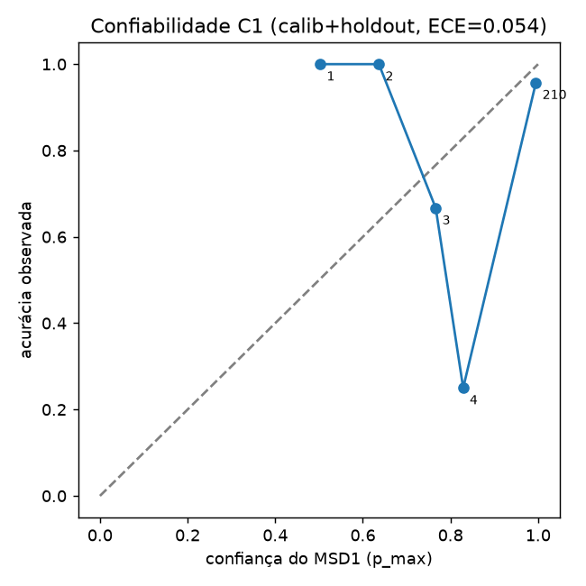
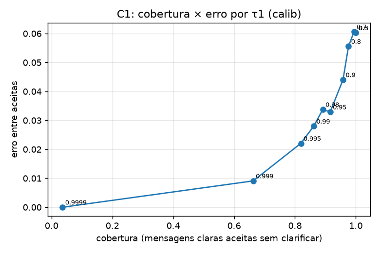
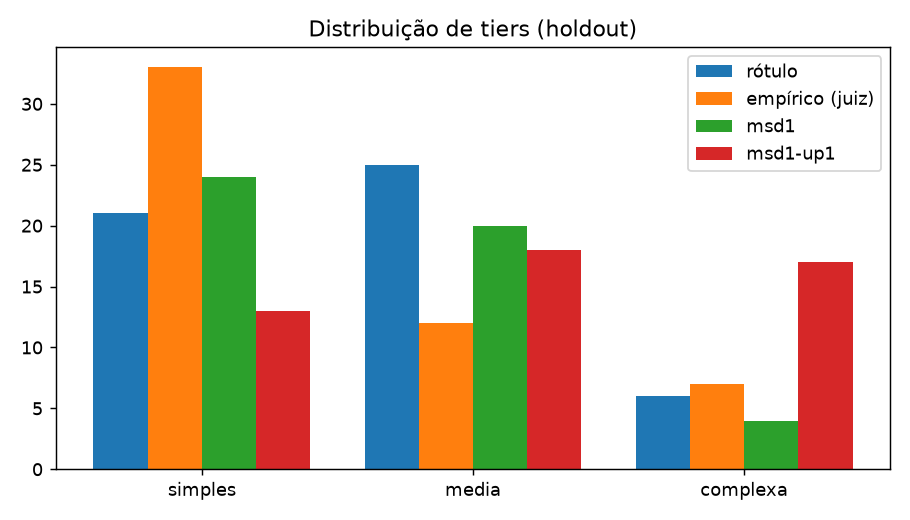
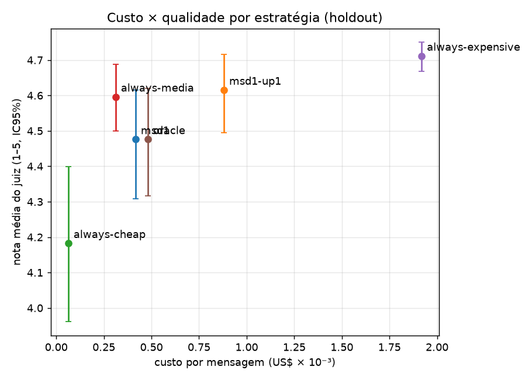
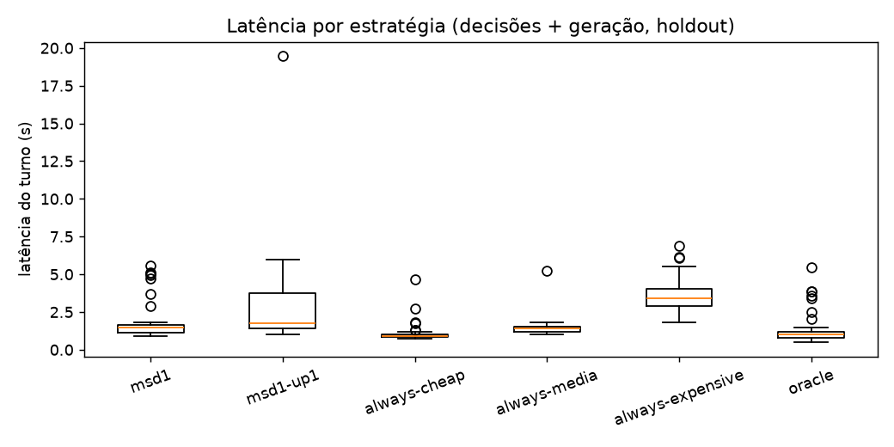

# Resultados — POC modelos de decisão (Fase 2)

Rodada: `20261012-holdout-live` (holdout, 60 mensagens × 6 estratégias), iniciada 2026-10-12T08:57:56-0300 (horário de SP). Calibração: `20261012-085619-calib-live` (180 mensagens do split calib).
Dataset: `datasets/mensagens.jsonl` (sha256 `cc346be4ce63e35a…`, 300 mensagens fictícias que eu escrevi e rotulei; rótulos ainda pendentes de revisão cruzada). Thresholds congelados antes do holdout: τ1=0.9, τ2=0.5 (fallback → complexa), τ2_up1=0.98 (fallback +1 tier).
Obs.: o sha256 registrado no manifest da rodada é o da versão do arquivo antes de eu renomear um campo de metadados (`rotulo_autor` → `rotulo_status`); mensagens, rótulos e splits são idênticos.
Tudo abaixo é regenerado por `.venv/bin/python -m harness.report runs/20261012-holdout-live runs/20261012-085619-calib-live`.

Neste relatório eu comparo, no split de teste (holdout), o chatbot com as duas camadas de decisão do Microsoft-Decision-1 contra baselines de modelo fixo.

## Resumo

- **Camada 1 (routing)**: acurácia bruta do MSD1 nas mensagens claras = **94.4%** no holdout (94.0% no calib). Com τ1=0.9: clarificação 8.3% (desnecessária 5.6%), erro entre aceitas 3.9%, ambíguas bem tratadas 100.0%.
- **Camada 2 (modelo)**: acerto do tier vs. rótulo 70.8% (msd1); sub-roteamento 22.9%, super-roteamento 6.2%, fallback 2.1%.
- **Custo × qualidade**: msd1 custa 78.3% menos que always-expensive (IC95% 67.9%–86.7%) com nota 4.48 vs 4.71 (always-cheap: 4.18).
- **Fronteira de Pareto (custo↓, nota↑)**: msd1-up1, always-cheap, always-media, always-expensive. Dominadas: msd1 (por always-media), oracle (por msd1, always-media).
- **Gasto total no OpenRouter (ledger local, Fases 1+2)**: **US$0.2971** em 1144 chamadas.

## Camada 1 — routing de subagente (MSD1 `choice`)

| Métrica | Holdout (τ1) | Holdout (sem τ) | Calib (τ1) |
|---|---:|---:|---:|
| Acurácia (claras, escolha bruta) | 94.4% | 94.4% | 94.0% |
| Taxa de clarificação | 8.3% | 0.0% | 6.7% |
| Clarificação desnecessária (claras) | 5.6% | 0.0% | 4.2% |
| Erro entre aceitas (claras) | 3.9% | 5.6% | 4.4% |
| Ambíguas: clarificou ou rótulo aceito | 100.0% | 100.0% | 78.6% |
| n | 60 | 60 | 180 |

ECE (calib+holdout, claras): **0.054**. Latência da decisão C1: P50 229 ms, P95 401 ms; C2: P50 237 ms, P95 417 ms (medido de um servidor Linux em São Paulo).

Matriz de confusão (holdout, com τ1; linhas = rótulo, colunas = decisão):

| rótulo \ decisão | devolucao | suporte | financeiro | fora_de_escopo | clarificar |
|---|---|---|---|---|---|
| devolucao | 20 | 1 | 0 | 0 | 2 |
| suporte | 0 | 11 | 0 | 1 | 1 |
| financeiro | 0 | 0 | 16 | 0 | 0 |
| fora_de_escopo | 0 | 0 | 0 | 2 | 0 |
| clarificar | 0 | 2 | 2 | 0 | 2 |

 

## Camada 2 — escolha do modelo (MSD1 `score`)

| Variante | n | Acerto vs rótulo | Sub-roteamento | Super-roteamento | Fallback | simples/média/complexa |
|---|---:|---:|---:|---:|---:|---|
| msd1 (τ2, fallback→complexa) | 48 | 70.8% | 22.9% | 6.2% | 2.1% | 24/20/4 |
| msd1-up1 (τ2_up1, fallback +1) | 48 | 58.3% | 6.2% | 35.4% | 56.2% | 13/18/17 |

No calib (subagente correto, escolha bruta sem τ), o acerto do tier foi 69.1% (n=149).
Tier empírico (o mais barato cuja nota do juiz fica a ≤0,25 da melhor): {'complexa': 7, 'simples': 33, 'media': 12}; concorda com os meus rótulos em 47.9% dos casos — os rótulos de complexidade são frágeis.

## Ponta a ponta — qualidade × custo × latência (holdout)

| Estratégia | Custo total US$ | US$/msg | Economia vs caro (IC95%) | Nota juiz (IC95%) | % nota ≥4 | US$/resposta boa | Lat P50 / P95 (s) | Overhead decisão | Truncadas |
|---|---:|---:|---:|---:|---:|---:|---:|---:|---:|
| msd1 | 0.0250 | 0.000417 | 78.3% (67.9%–86.7%) | 4.48 (4.31–4.62) | 90.4% | 0.00053 | 1.34 / 5.07 | 36.4% | 0.0% |
| msd1-up1 | 0.0528 | 0.000880 | 54.1% (42.4%–65.4%) | 4.62 (4.50–4.72) | 96.2% | 0.00106 | 1.67 / 5.95 | 30.2% | 0.0% |
| always-cheap | 0.0038 | 0.000063 | 96.7% (96.4%–97.0%) | 4.18 (3.96–4.40) | 71.2% | 0.00010 | 0.90 / 1.82 | 25.1% | 0.0% |
| always-media | 0.0187 | 0.000312 | 83.7% (82.1%–85.3%) | 4.60 (4.50–4.69) | 96.2% | 0.00037 | 1.28 / 1.78 | 18.0% | 0.0% |
| always-expensive | 0.1151 | 0.001919 | 0.0% (0.0%–0.0%) | 4.71 (4.67–4.75) | 100.0% | 0.00221 | 3.18 / 6.07 | 6.9% | 0.0% |
| oracle | 0.0289 | 0.000481 | 74.9% (64.2%–85.2%) | 4.48 (4.32–4.62) | 88.5% | 0.00063 | 0.93 / 3.85 | 0.0% | 0.0% |

Custo inclui as decisões MSD1 (pagas por todas as estratégias, exceto oracle) e a geração; clarificações e fora de escopo custam só a decisão. Nota do juiz = média de correção, resolução, política e tom (1–5), só nas respostas geradas.

Truncamento por modelo (finish_reason): `google/gemini-2.5-flash-lite` stop=110; `google/gemini-3.5-flash-lite` stop=119; `openai/gpt-6-sol` stop=83. max_tokens: Gemini 400, GPT-6 Sol 800.

## Gasto

- Ledger local (`runs/ledger.json`, soma de `usage.cost`): **US$0.2971**, 1144 chamadas.

| Modelo | US$ |
|---|---:|
| `openai/gpt-6-sol` | 0.1999 |
| `google/gemini-3.5-flash-lite` | 0.0454 |
| `deepseek/deepseek-v4.1-flash` | 0.0413 |
| `google/gemini-2.5-flash-lite` | 0.0072 |
| `microsoft/microsoft-decision-1` | 0.0033 |

- Conferência OpenRouter (GET /api/v1/key, no momento do relatório): uso = US$0.2971, limite US$20.

## Limitações

- **Rotulei sozinho** (subagente e tier); os rótulos ainda estão pendentes de revisão cruzada (`report/revisao_rotulos.csv`). O tier empírico mostra que o meu rótulo de complexidade diverge bastante, então leio os números da C2 com cautela.
- **Juiz único e barato** (DeepSeek V4.1 Flash), ainda sem a minha calibração manual; a planilha cega de 40 itens que vou preencher está em `runs/20261012-holdout-live/revisao_humana_juiz.csv` (chave em `revisao_humana_chave.json`). Viés de verbosidade possível a favor do modelo caro.
- **Holdout pequeno** (60 mensagens, ~52 geradas por estratégia): ICs largos; diferenças de nota < ~0,3 não são conclusivas.
- Mensagens de turno único e sintéticas, todas escritas por mim (provável homogeneidade de estilo); ferramentas mock injetadas no prompt, sem tool-calling real.
- Calibrei os τ com uma função de utilidade que eu defini; outros pesos mudariam os τ. A C2 do calib usou o subagente correto; no holdout usou o escolhido pela C1.
- Medi a latência de um único servidor Linux em São Paulo, num horário só; geração depende do provedor servido pelo OpenRouter.
- Não rodei os baselines de router gerativo/Jev/OpenAI Decisions nesta rodada.

## Minha conclusão

- A Camada 1 funcionou bem: o MSD1 roteou 94.4% das mensagens claras corretamente, com probabilidades bem calibradas (ECE 0.054) e ~229 ms por decisão; o τ1 trocou erro por clarificação de forma controlada.
- A Camada 2, do jeito que eu montei, não se pagou: always-media custou US$0.000312/msg com nota 4.60, contra US$0.000417/msg e nota 4.48 do msd1. A variante +1 tier chegou a 4.62, mas a 54.1% de economia.
- O gargalo é a definição de complexidade (meus rótulos discordam do tier empírico em metade dos casos), não a latência nem o custo da decisão, que são desprezíveis.

## Evidências

- `runs/20261012-holdout-live/` — decisions.jsonl, turns.jsonl, judge.jsonl, manifest.json, revisao_humana_juiz.csv
- `runs/20261012-085619-calib-live/` — decisions.jsonl, calibracao.json (curvas de utilidade de τ1/τ2)
- `config/thresholds.json` (τ congelados), `config/prices.json` (preços datados)
- `report/tabelas/estrategias.csv`, `report/graficos/*.png`, `report/exemplos-routing.md`
- `ESTIMATIVA_CUSTO.md` (estimativa que fiz antes da rodada)
