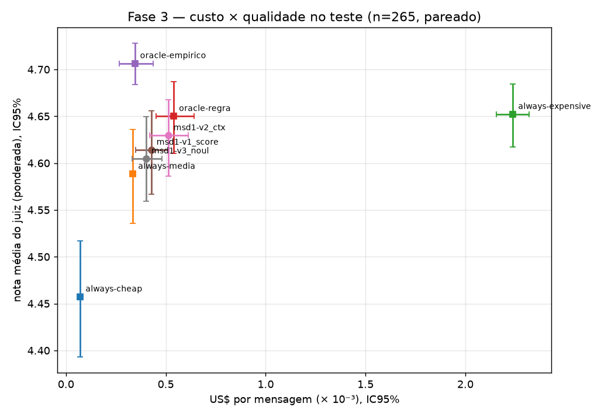
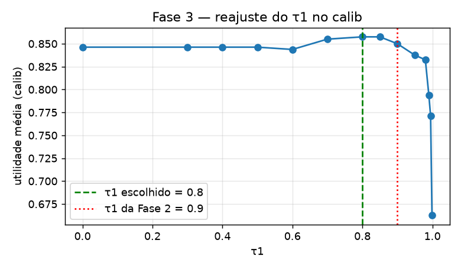
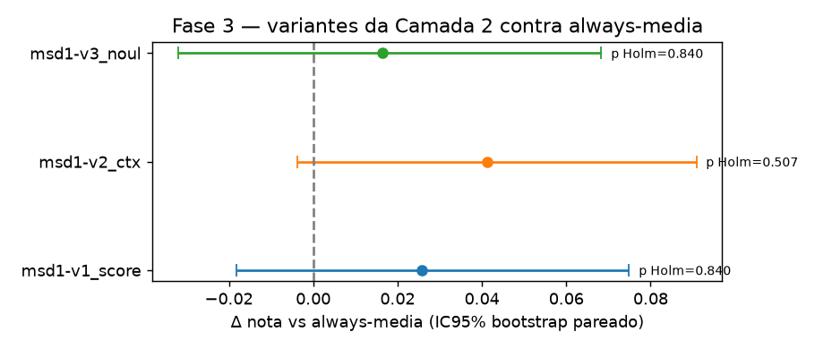
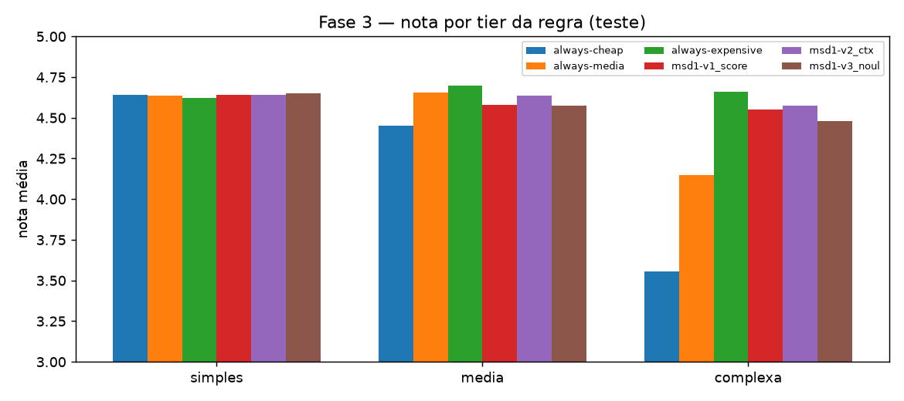
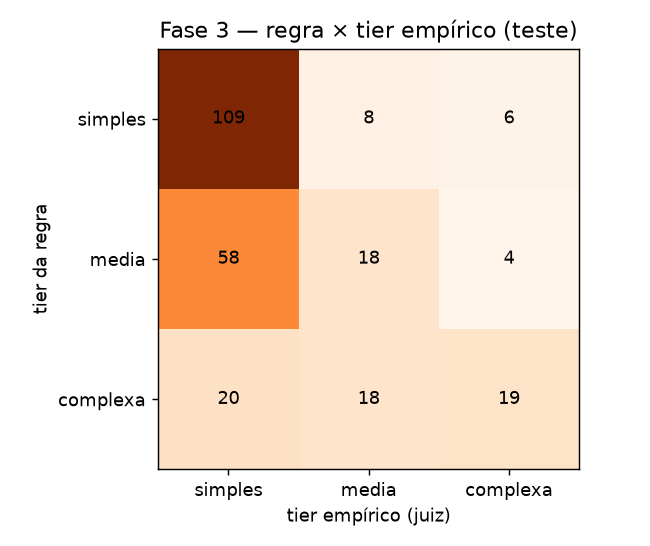
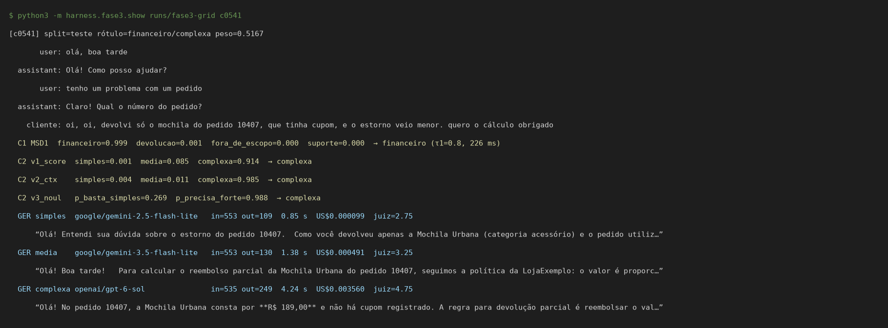

# Resultados da Fase 3 — a conclusão da Fase 2 se mantém?

Executei a Fase 3 em 12/10/2026 (09:50–10:05, horário de São Paulo), seguindo o [`PLANO_FASE3.md`](PLANO_FASE3.md). As tabelas completas, geradas automaticamente, estão em [`report/fase3/RESULTADOS_FASE3.md`](report/fase3/RESULTADOS_FASE3.md) e [`report/fase3/replay_resultado.json`](report/fase3/replay_resultado.json).

> **Sobre os dados:** as 1000 conversas são fictícias, geradas por templates escritos com apoio de um LLM. Os rótulos (subagente e tier) também foram gerados com apoio de um LLM, a partir de regras, e **ainda não passaram por revisão humana**. A qualidade é medida por um único juiz automático (DeepSeek V4.1 Flash), ainda não calibrado contra notas humanas.

## Resposta curta

**A conclusão da Fase 2 muda em parte.**

- **O que muda:** com mais dados, conversas multi-turno e distribuição realista, o msd1 **deixou de ser dominado** por always-media. Agora ele tem nota maior e custo maior, ou seja, fica em outro ponto da curva custo × qualidade.
- **O que se mantém:** a vantagem de nota sobre always-media **não é estatisticamente significativa** (Δ +0,016 a +0,041; p de Holm ≥ 0,51), e a taxa de "passa" fica no limite (McNemar com Holm: p = 0,054–0,057).
- **Contra always-expensive:** a qualidade é **estatisticamente indistinguível** (todos os IC95% de Δnota incluem zero), com **77–82% menos custo**.
- **Onde está o ganho:** concentrado na cauda complexa. Numa análise exploratória (post hoc), o msd1 ganha +0,33 a +0,43 ponto de always-media nas conversas complexas (p ≤ 0,0006).
- **O oracle empírico** (sabendo de antemão qual o tier mais barato que resolve) chegaria a nota 4,706 pelo custo de always-media. Há espaço para um roteador melhor; o gargalo continua sendo identificar quais mensagens precisam de mais modelo.



## O que rodei

- **Coleta:** 1000 conversas passaram pela Camada 1 (1000 chamadas). Fiz 2721 chamadas de Camada 2, distribuídas pelas 3 variantes. Para as conversas selecionadas para geração, respondi com os 3 modelos e passei cada resposta pelo juiz (1251 gerações).
  - 1 avaliação do juiz voltou sem nota e foi excluída.
  - Nenhuma resposta foi truncada.
- **Ajuste só no calib, congelado antes do teste:** gravei τ1 e os parâmetros da C2 em [`config/fase3_congelado.json`](config/fase3_congelado.json) às 09:54 (commit `5af13dd`, enviado ao GitHub antes de eu calcular qualquer métrica de teste).
- **Avaliação no teste por replay:** 265 conversas avaliáveis (aceitas pela C1 e com as 3 respostas julgadas). Médias ponderadas pelo `peso`, que desfaz a sobreamostragem da cauda complexa.
- **Estatística:**
  - bootstrap pareado (5000 reamostragens) para os IC95%;
  - teste de permutação por troca de sinal (nota);
  - McNemar na taxa de "passa" (média ≥ 4,5 e política ≥ 4);
  - correção de Holm nas 6 comparações principais.

## Reajuste do τ1 (de graça, com o routing já salvo)

Reajustei o τ1 no calib da Fase 3 com a mesma função de utilidade da Fase 2. O valor escolhido foi **0,8** (era 0,9).

| τ1 | split | acurácia (claras) | clarificação | clarificação desnecessária | erro entre aceitas | ambíguas ok | utilidade |
|---|---|---:|---:|---:|---:|---:|---:|
| 0,9 (Fase 2) | teste | 94,1% | 5,2% | 3,7% | 4,6% | 89,5% | 0,848 |
| **0,8 (reajustado)** | teste | 94,1% | 2,8% | 2,1% | 4,7% | 81,6% | 0,848 |
| 0 (sem threshold) | teste | 94,1% | 0,0% | 0,0% | 5,9% | 81,6% | 0,841 |

No calib, 0,8 teve utilidade 0,858 contra 0,850 de 0,9. **No teste, a utilidade empatou (0,848).** O τ1 mais baixo pergunta menos (2,8% vs 5,2%), mas trata pior as ambíguas (81,6% vs 89,5%). A Camada 1 continua sólida: 94,1% de acurácia nas mensagens claras do teste.



## Camada 2 — as três variantes

Parâmetros congelados no calib (critério pré-registrado: nota ≥ always-media − 0,05 e o menor custo entre os que passam):

| variante | o que pergunta ao MSD1 | parâmetros | acerto vs regra (teste, n=518) |
|---|---|---|---:|
| `v1_score` | complexidade 0–2 (pergunta da Fase 2), sem contexto | τ2 = 0 | 84,7% |
| `v2_ctx` | complexidade 0–2 focada em cruzar pedido × política, **com** dados da ferramenta | τ2 = 0,8, fallback +1 tier | **88,0%** |
| `v3_noul` | duas perguntas sim/não ("o simples basta?", "precisa do forte?"), com contexto | ta = 0,7, tb = 0,3 | 69,9% |

### Teste (265 conversas, médias ponderadas)

| estratégia | nota | % passa | US$/msg | economia vs always-expensive | sub-roteamento vs empírico | latência P50 / P95 | simples/média/complexa |
|---|---:|---:|---:|---:|---:|---:|---|
| always-cheap | 4,457 | 79,8% | 0,000072 | 96,8% | 22,7% | 0,94 / 1,77 s | 265/0/0 |
| always-media | 4,588 | 85,9% | 0,000335 | 85,0% | 8,0% | 1,33 / 1,92 s | 0/265/0 |
| always-expensive | 4,652 | 89,2% | 0,002238 | — | 0,0% | 3,50 / 5,63 s | 0/0/265 |
| **msd1-v1_score** | 4,614 | 88,5% | 0,000427 | 80,9% | 12,2% | 1,40 / 5,04 s | 160/61/44 |
| **msd1-v2_ctx** | 4,629 | 88,7% | 0,000512 | 77,1% | 11,5% | 1,47 / 4,98 s | 149/64/52 |
| **msd1-v3_noul** | 4,605 | 87,2% | 0,000401 | 82,1% | 12,3% | 1,41 / 4,82 s | 158/66/41 |
| oracle-regra | 4,650 | 91,8% | 0,000540 | 75,9% | 7,8% | 1,29 / 5,31 s | 123/85/57 |
| oracle-empírico | 4,706 | 96,7% | 0,000345 | 84,6% | 0,0% | 1,02 / 4,47 s | 191/45/29 |

### Comparações pareadas (teste)

| comparação | Δ nota (IC95%) | p permutação | p Holm | Δ US$/msg (IC95%) | McNemar p | McNemar p Holm | passa só A / só B |
|---|---:|---:|---:|---:|---:|---:|---:|
| v1_score vs always-media | +0,026 (−0,018; +0,075) | 0,280 | 0,840 | +0,000092 (+0,000016; +0,000173) | 0,011 | 0,057 | 26 / 10 |
| v2_ctx vs always-media | +0,041 (−0,004; +0,091) | 0,085 | 0,508 | +0,000177 (+0,000090; +0,000270) | 0,009 | 0,054 | 25 / 9 |
| v3_noul vs always-media | +0,016 (−0,032; +0,068) | 0,522 | 0,840 | +0,000066 (−0,000001; +0,000140) | 0,108 | 0,433 | 25 / 14 |
| v1_score vs always-expensive | −0,038 (−0,091; +0,013) | 0,157 | 0,628 | −0,001811 (−0,001903; −0,001718) | 0,461 | 0,923 | 20 / 26 |
| v2_ctx vs always-expensive | −0,023 (−0,074; +0,028) | 0,382 | 0,840 | −0,001726 (−0,001824; −0,001628) | 0,461 | 0,923 | 20 / 26 |
| v3_noul vs always-expensive | −0,047 (−0,102; +0,005) | 0,089 | 0,508 | −0,001837 (−0,001931; −0,001743) | 0,152 | 0,457 | 19 / 30 |



### Onde a diferença aparece: a cauda complexa

| estratégia | nota em "simples" | nota em "média" | nota em "complexa" |
|---|---:|---:|---:|
| always-cheap | 4,64 | 4,45 | 3,56 |
| always-media | 4,64 | 4,66 | 4,15 |
| always-expensive | 4,62 | 4,70 | 4,66 |
| msd1-v1_score | 4,64 | 4,58 | 4,55 |
| msd1-v2_ctx | 4,64 | 4,63 | 4,57 |
| msd1-v3_noul | 4,65 | 4,58 | 4,48 |

Análise **exploratória**, decidida depois de ver a tabela acima (não estava no plano, sem correção adicional): nas 57 conversas complexas do teste, o msd1 supera always-media em +0,404 (IC95% +0,259; +0,557; p = 0,0002) com v1, +0,425 (+0,268; +0,588; p = 0,0002) com v2 e +0,329 (+0,158; +0,500; p = 0,0006) com v3. Em troca, custa cerca de US$0,0017–0,0020 a mais por mensagem nesse grupo.



Minha leitura: em mensagens simples os três modelos empatam, então o roteamento não muda nada ali. A diferença está na cauda complexa, onde always-media cai para 4,15 e o msd1 recupera quase tudo. Como a cauda é ~12% das conversas, o ganho médio fica pequeno e não significativo.

## Por que o rótulo de complexidade bate tão pouco com o tier empírico

Na Fase 3, o rótulo por regra concorda com o tier empírico em 55,6% (relativo) e 58,4% (absoluto), contra 47,9% na Fase 2. A discordância é quase toda num sentido: **o empírico é mais barato que o rótulo** (147 casos, contra 31 no sentido oposto). Em conversas com nº de pedido, o modelo barato passa em 53,8%; sem pedido, em 91,8%. Detalhes em [`report/fase3/tier_fase3/analise_tier_empirico.md`](report/fase3/tier_fase3/analise_tier_empirico.md).



## Exemplo real

Uma conversa complexa do teste em que o modelo barato e o médio erram o cálculo do reembolso parcial, e as três variantes do MSD1 mandam corretamente para o GPT-6 Sol:



```text
$ python3 -m harness.fase3.show runs/fase3-grid c0541
[c0541] split=teste rótulo=financeiro/complexa peso=0.5167
       user: olá, boa tarde
  assistant: Olá! Como posso ajudar?
       user: tenho um problema com um pedido
  assistant: Claro! Qual o número do pedido?
    cliente: oi, oi, devolvi só o mochila do pedido 10407, que tinha cupom, e o estorno veio menor. quero o cálculo obrigado
  C1 MSD1  financeiro=0.999  devolucao=0.001  fora_de_escopo=0.000  suporte=0.000  → financeiro (τ1=0.8, 226 ms)
  C2 v1_score  simples=0.001  media=0.085  complexa=0.914  → complexa
  C2 v2_ctx    simples=0.004  media=0.011  complexa=0.985  → complexa
  C2 v3_noul   p_basta_simples=0.269  p_precisa_forte=0.988  → complexa
  GER simples  google/gemini-2.5-flash-lite   in=553 out=109  0.85 s  US$0.000099  juiz=2.75
  GER media    google/gemini-3.5-flash-lite   in=553 out=130  1.38 s  US$0.000491  juiz=3.25
  GER complexa openai/gpt-6-sol               in=535 out=249  4.24 s  US$0.003560  juiz=4.75
```

E um erro de roteamento: uma pergunta de política sem resposta na base, que só o GPT-6 Sol tratou bem ao admitir que a política não cobre o caso. v1 e v2 mandaram para o modelo barato:

```text
$ python3 -m harness.fase3.show runs/fase3-grid c0485
[c0485] split=teste rótulo=devolucao/simples peso=1.15
    cliente: devolução vale pra loja física?
  C2 v1_score  simples=0.999  media=0.001  complexa=0.000  → simples
  C2 v2_ctx    simples=0.992  media=0.007  complexa=0.002  → simples
  C2 v3_noul   p_basta_simples=0.378  p_precisa_forte=0.002  → media
  GER simples  google/gemini-2.5-flash-lite   in=348 out=58  0.66 s  US$0.000058  juiz=3.5
  GER media    google/gemini-3.5-flash-lite   in=348 out=65  0.93 s  US$0.000267  juiz=3.5
  GER complexa openai/gpt-6-sol               in=328 out=149  3.51 s  US$0.002146  juiz=4.75
      “A política que tenho não informa se a devolução vale para compras feitas em loja física nem se é possível levar até lá um pedido online. Voc…”
```

## Gasto

- Coleta da Fase 3: US$0,4647 (calib) + US$0,8841 (teste) = **US$1,35**, abaixo da estimativa central de US$2,56.
- Ledger acumulado (Fases 1, 2 e 3, incluindo os smoke tests): **US$1,6639** em 7418 chamadas.

| modelo | US$ |
|---|---:|
| `openai/gpt-6-sol` | 1,2057 |
| `google/gemini-3.5-flash-lite` | 0,1929 |
| `deepseek/deepseek-v4.1-flash` | 0,1906 |
| `microsoft/microsoft-decision-1` | 0,0398 |
| `google/gemini-2.5-flash-lite` | 0,0349 |

## Limitações

- **Dados e rótulos gerados com apoio de um LLM, sem revisão humana.** As conversas vêm de templates e são mais homogêneas que as reais. Há artefatos visíveis, como o "oi, oi" duplicado no exemplo c0541.
- **Juiz único e com teto:** muitas notas saturam em 4,75, o que comprime as diferenças. Ainda não comparei o juiz com notas humanas.
- **Replay:** cada resposta é uma amostra única. Todas as estratégias reaproveitam a mesma resposta por tier, o que é ótimo para o pareamento mas não captura variação entre amostras.
- **Ajuste da Camada 2:** feito com 140 conversas de calib. O critério ("nota ≥ always-media − 0,05, menor custo") levou o v1 a τ2 = 0, ou seja, sem fallback.
- **A análise da cauda complexa é post hoc.**
- **Latência** medida de uma única máquina, numa só janela de horário, com requisições em paralelo.

## Evidências

- Coleta: `runs/fase3-grid/grid.jsonl` (C1, C2, gerações e juiz por conversa), `runs/fase3-grid/manifest-*.json`, `runs/fase3-grid-calib.log`, `runs/fase3-grid-teste.log`
- Parâmetros congelados: `config/fase3_congelado.json`
- Tabelas geradas: `report/fase3/RESULTADOS_FASE3.md`, `report/fase3/replay_resultado.json`
- Tier empírico: `report/fase3/tier_fase3/analise_tier_empirico.md`, `report/fase3/tier_fase3/tier_empirico.csv`
- Gráficos: `report/graficos/fase3/*.png`
- Gasto: `runs/ledger.json`
- Para reproduzir: `python3 -m harness.fase3.replay runs/fase3-grid --out report/fase3` e `.venv/bin/python -m harness.fase3.figuras runs/fase3-grid`
